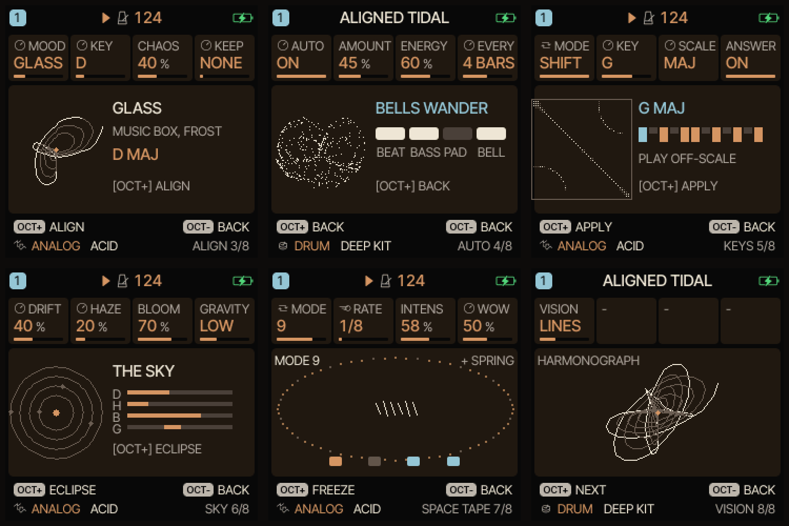

<h1 align="center">ANDROMEDA · FM-1</h1>

<i>an ambient instrument</i> — free, open-source firmware for the M-VAVE FM-1 
Dark Funk Durcal design · Created at <b>Polaris Sound Lab</b>, Mérida, Yucatán, México 
<a href="https://www.instagram.com/polaris.sound.lab/">Instagram @polaris.sound.lab</a> · <a href="https://www.youtube.com/@PolarisSoundLab">YouTube @PolarisSoundLab</a>

<a href="https://drophlex.github.io/ANDROMEDA/fm1/"><b>🎛 Install it</b></a> &nbsp;·&nbsp;
<a href="https://drophlex.github.io/ANDROMEDA/guide/#fm1"><b>✦ Quick guide</b></a> &nbsp;·&nbsp;
<a href="manual/ANDROMEDA-FM1-Manual-EN-ES.pdf"><b>📘 Manual EN + ES</b></a> &nbsp;·&nbsp;
<a href="https://www.paypal.com/donate/?business=drophlex%40gmail.com&no_recurring=0&item_name=ANDROMEDA&currency_code=USD"><b>♥ Donate</b></a>

**English** · [Español](#español)

## ⚡ Quick guide

1. **Connect** the FM-1 (battery charged) to a computer with a USB-C **data** cable. Open **[the installer](https://drophlex.github.io/ANDROMEDA/fm1/)** in **Chrome or Edge**.
2. **Install**: press *Install*, allow MIDI, and don't unplug while it says *Writing* (about 5 minutes). The official firmware can always go back from the same page.
3. **Play**: press **HOME** until **ALIGN**, choose a mood with **K1**, press **OCT+**, then **PLAY**. Go to **AUTO** and turn **K1** on: the music keeps growing by itself.
4. **Español**: the screen is in English; on the **VISION** page turn **K4 (LANG)** to **ES** and the whole screen reads in Spanish. The FM-1 remembers it.

| | |
|---|---|
| 🎛 **Installer** | [drophlex.github.io/ANDROMEDA/fm1](https://drophlex.github.io/ANDROMEDA/fm1/) · also in [`install/`](install/) and every [Release](https://github.com/drophlex/ANDROMEDAFM1/releases/latest) |
| 📘 **Manual** | FM-1: [English + Español](manual/ANDROMEDA-FM1-Manual-EN-ES.pdf) · [Solo español](manual/ANDROMEDA-FM1-Manual-ES.pdf) — from installing to every page, with pictures |
| 📚 **Complete manual** | web, Mac, Ableton **and** FM-1: [English + Español](manual/ANDROMEDA-Manual-Completo-EN-ES.pdf) · [Solo español](manual/ANDROMEDA-Manual-Completo-ES.pdf) |
| 🌐 **Web, Mac app, Ableton plug-in** | the same instrument on a computer: [drophlex.github.io/ANDROMEDA](https://drophlex.github.io/ANDROMEDA/) · [source](https://github.com/drophlex/ANDROMEDA) |
| ♥ **Free & open source** | GPL-3.0. If it brings you good moments: [donate with PayPal](https://www.paypal.com/donate/?business=drophlex%40gmail.com&no_recurring=0&item_name=ANDROMEDA&currency_code=USD) |

## What it does

ANDROMEDA turns the FM-1 into an ambient instrument that always sounds good and keeps playing by itself. It is
[Felucca 1.8.2](https://github.com/hugelton/Felucca) (GPL-3.0, Hügelton Instruments) with every sound and feature kept, plus
six pages after HOME › MIXER › CLOCK (press **HOME** to go through them; **OCT+** is each page's action):

| Page | Knobs | OCT+ |
|---|---|---|
| **ALIGN** | MOOD (13: DRIFT, TIDAL, HAZE, GLASS, PULSE, RUST, BREATH, LULLABY, ORBIT, ABYSS, CHROME, DAWN, STATIC) · KEY · CHAOS · KEEP | **ALIGN**: the four tracks written at once — a soft beat or a texture, the bass, the pad's chords, bells or a melody — with tempo, echo and space. Always in key. |
| **AUTO** | AUTO · AMOUNT · ENERGY · EVERY (2/4/8 bars) | **BACK** to your pattern. AUTO keeps the music growing from *your* pattern: every few bars one part changes a little with its own intervals and rhythms (strong beats on the chord) and the parts fade in and out with ENERGY. |
| **KEYS** | MODE (RAW / SNAP / SHIFT) · KEY · SCALE · ANSWER | **APPLY** the key to every track. SHIFT: play a note outside the scale and the whole song moves to the nearest scale on the next beat. ANSWER: the bells answer what you play. |
| **SKY** | DRIFT · HAZE · BLOOM · GRAVITY | **ECLIPSE**: the beat sinks into the echoes (again: it returns). |
| **SPACE TAPE** | MODE 1–12 (three heads, spring) · RATE · INTENSITY · WOW | **FREEZE** |
| **VISION** | K1 CYMATICS · HARMONOGRAPH · ATTRACTOR · ORRERY · K4 **LANG** (EN / ES) | next vision |

Also: 6 new ambient sounds on ANALOG (POLAR PAD, PWM DREAM, GLASS PAD, WARM PULSE, SUB GRAVITY, DREAM SAW), a 32-voice FM bank
(FM6 SLOT B1–B32), the COSMOS colours (MENU › COLOR), a harmonograph on HOME and at power-on.

## Build it

The firmware is built by GitHub Actions ([`.github/workflows/build.yml`](.github/workflows/build.yml)) on every change: the
JieLi toolchain, three files of the AC79 SDK, `firmware-src/build.sh --release 1.8.2-an1 --identity FM-1_947`, the host tests
(`firmware-src/tests/run_tests.sh`, with ANDROMEDA's own `tests/andro_test.c`), then the installer
(`tools/make_installer.py`) and a Release. See [`firmware-src/BUILDING.md`](firmware-src/BUILDING.md) to build it yourself.

## Credits and licences

- **ANDROMEDA** — Dark Funk Durcal design, created at **Polaris Sound Lab**, Mérida, Yucatán, México.
- Based on **Felucca 1.8.2** by Hügelton Instruments — GPL-3.0, no warranty (`firmware-src/LICENSE`, `firmware-src/LICENSING.md`).
  Felucca-Engines (MIT), felucca-bsp (MPL-2.0), FM6 engine from Dexed / msfa (Apache-2.0), Inter Tight font (SIL OFL 1.1),
  samples VSCO-2 CE and VCSL (CC0). The tape echo and the FM bank come from Dark Funk Durcal Synt (Polaris Sound Lab).
- M-VAVE and FM-1 are trademarks of their respective owners. This firmware is not an official M-VAVE product. Install it at
  your own risk, following the manual. The installer can always take you back to the official firmware.

---

## Español

**ANDROMEDA** convierte el FM-1 en un instrumento ambient que siempre suena bien y sigue tocando solo. Conserva todos los sonidos
y funciones de Felucca 1.8.2 y agrega seis páginas después de HOME › MIXER › CLOCK (presiona **HOME** para recorrerlas; **OCT+**
es la acción de cada página):

- **ALIGN**: elige un estado (13) y **OCT+**: escribe las cuatro pistas a la vez, siempre en tono.
- **AUTO**: la música sigue creciendo a partir de *tu* patrón; ENERGY decide cuántas partes suenan; **OCT+** vuelve a tu patrón.
- **KEYS**: RAW / SNAP / SHIFT. Con SHIFT, si tocas una nota fuera de la escala, toda la canción pasa a la escala más cercana
  en el siguiente tiempo. ANSWER: las campanas contestan lo que tocas.
- **SKY**: DRIFT, HAZE, BLOOM, GRAVITY; **OCT+** ECLIPSE.
- **SPACE TAPE**: el eco de cinta de tres cabezas con resorte, 12 modos; **OCT+** FREEZE.
- **VISION**: cimática, armonógrafo, atractor y órbitas dibujados con la música. **K4 (LANG)** pone toda la pantalla en español.

**Instalar:** abre [el instalador](https://drophlex.github.io/ANDROMEDA/fm1/) en Chrome o Edge con el FM-1
conectado por un cable USB-C de **datos**, presiona **Install**, permite el MIDI y no lo desconectes mientras dice *Writing*.
El [manual](manual/ANDROMEDA-FM1-Manual-ES.pdf) trae cada paso con imágenes.

**Gratis y de código abierto** (GPL-3.0). Si te gusta, puedes apoyarlo: [♥ donar con PayPal](https://www.paypal.com/donate/?business=drophlex%40gmail.com&no_recurring=0&item_name=ANDROMEDA&currency_code=USD).
